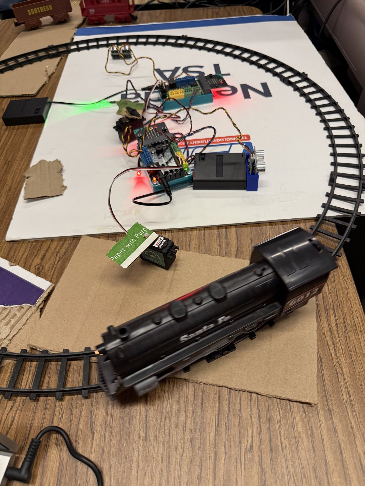

# Project 2: Automated Railroad Crossing

## Project Overview

For this project I built an automated railroad crossing using Snap! and the Hummingbird robot kit. It stops traffic so cars and trains don't crash. When a train comes, a barrier goes down to block the road. When the train leaves, the barrier goes back up. It also records the time and date of each train.

### Parts Used

- micro:bit
- Hummingbird Breakout Board
- Battery pack
- Red LED and RGB LED
- Distance sensor
- Position servo

## Planning & Design

I didn't make any sketches for this project. Instead, I looked online at pictures of real railroad crossings and used them as references. They gave me ideas for how my crossing should look and work.

## Build Process

First, I looked at pictures of railroad crossings for reference. Then I wrote the code in Snap!. After that I built the crossing. Then I tested it. After testing, I changed my code and tested it again. Then I was finished.

This is my crossing from above. You can see the Hummingbird board, the distance sensor, the servo barrier, and the track.

This is the train at my crossing.

## Snap! Project Link

[My Snap! project: U2L2R Railroad Crossing](https://snap.berkeley.edu/snap/snap.html#present:Username=lvhs10&ProjectName=U2L2R%20Railroad%20Crossing)
