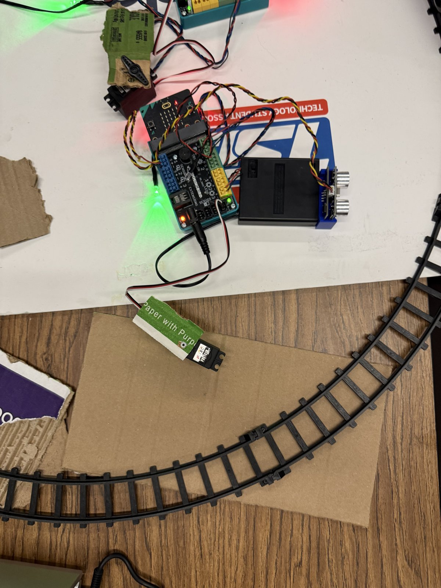
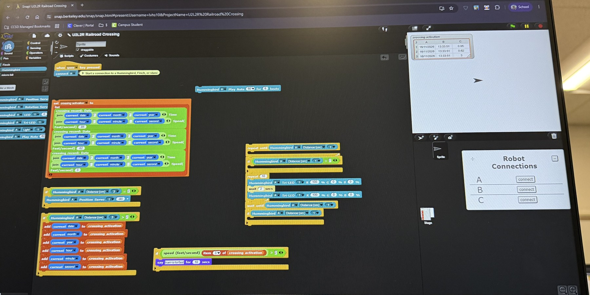

# Project 2: Automated Railroad Crossing

## Project Overview

For this project I built an automated railroad crossing using Snap! and the Hummingbird robot kit. It stops traffic so cars and trains don't crash. When a train comes, a barrier goes down to block the road. When the train leaves, the barrier goes back up. It also records the time and date of each train.

### Parts Used

- micro:bit
- Hummingbird Breakout Board
- Battery pack
- Red LED and RGB LED
- Distance sensor
- Position servo

## Planning & Design

I didn't make any sketches for this project. Instead, I looked online at pictures of real railroad crossings and used them as references. They gave me ideas for how my crossing should look and work.

## Build Process

First, I looked at pictures of railroad crossings for reference. Then I wrote the code in Snap!. After that I built the crossing. Then I tested it. After testing, I changed my code and tested it again. Then I was finished.

This is my crossing from above. You can see the Hummingbird board, the distance sensor, the servo barrier, and the track.

This is the train at my crossing.

## Code

This is my Snap! code. When the distance sensor sees the train, the code sends a warning, closes the gate, turns the lights red, and starts the siren. The servo is what moves the gate. When the train leaves, the gate opens again.

The red LED and the RGB LED make the traffic stop or go so cars don't cause collisions.

The code also keeps a timetable. The distance sensor and the code record the date, time, and speed of each train.

## Snap! Project Link

[My Snap! project: U2L2R Railroad Crossing](https://snap.berkeley.edu/snap/snap.html#present:Username=lvhs10&ProjectName=U2L2R%20Railroad%20Crossing)

## How It Works

**Input:** The distance sensor. It senses when the train is near the crossing.

**Processing:** My Snap! code checks the distance sensor. When it sees the train, the code sends a warning, closes the gate, and records the train in the timetable. When the train leaves, the code opens the gate again.

**Outputs:** The servo moves the gate. The red LED and the RGB LED make traffic stop or go. The siren makes a warning sound. The timetable records the date, time, and speed of each train.

## Testing & Debugging

### Problem 1: The gate opened when the train came

The gate was opening when the train came, which is the opposite of what it should do. I changed the location of the distance sensor. It took a few tries before it worked.

### Problem 2: The gate opened too early

The gate was opening too early, which would cause a crash. I changed the code and the position of the distance sensor, then tested it again.

## Final Product

This is my finished railroad crossing. When the train comes, the gate closes and the lights turn red. When the train leaves, the gate opens again. Here is a video of it working.

<video controls width="320">
  <source src="demo-video.mp4" type="video/mp4">
  Your browser does not support video.
</video>
